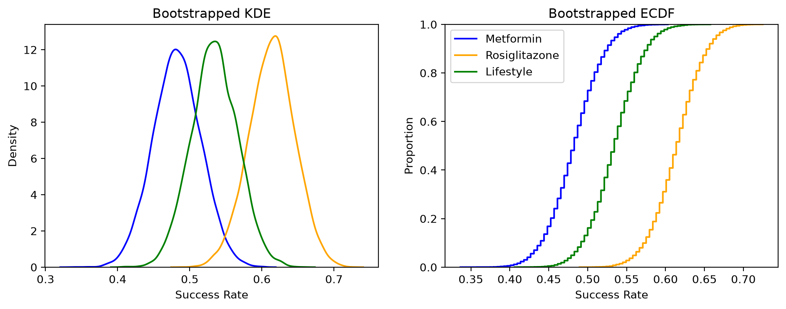
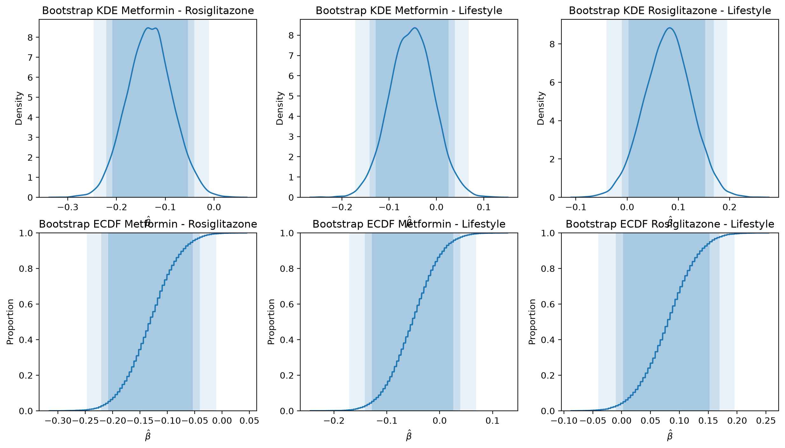

# Evidence Review: Metformin, Rosiglitazone, and Lifestyle Intervention
6. Write a short report (3-5 paragraphs) that summarizes the evidence from the trial for adopting each of the interventions or not. Use tables and visualizations. Write in a professional tone for a technical audience, and focus on evidence (or the lack thereof). Do not assume anyone has read your work in your notebooks.
## 1. Purpose, Data, and Methods

**Table 1. Outcomes by treatment arm**

| Arm | n | Successes | Success rate |
|---|---|---|---|
| Metformin | 232 | 112 | 0.483 |
| Rosiglitazone | 233 | 143 | 0.614 |
| Lifestyle | 234| 125 | 0.534 |

This report evaluates a randomized clinical trial (n = 699) comparing three interventions for preventing progression to type 2 diabetes: metformin, rosiglitazone, and lifestyle modification. Observed success rates were 48.3% for metformin, 61.4% for rosiglitazone, and 53.4% for lifestyle. Because assignment was randomized, differences in success rates estimate average treatment effects. To quantify uncertainty, I ran a boostrap with 10,000 resamples drawn with replacement within each arm, computed the three pairwise difference in each resample, and took percentile confidence intervals at the 90%, 95%, and 99% levels; a difference is called significant when its interval excludes 0.

## 2. Outcomes by Arm

Figure 1 shows the boostrap distributions of each arm's success rate, which have similar spreads, as expected given arms of roughly equal size (n=232 to 234). The rosiglitazone distribution sits clear to the right of metformin's with little overlap, while lifestyle falls between the two and overlaps substantially with both. The ECDFs tell the same story: the rosiglitazone curve is shifted furthest right, and the lifestyle curve lies between the other two. This ordering suggests rosiglitazone is the most effective arm, but the overlap between lifestyle and its neighbors means these point estimates alone do not establish which differences are real, which is what the following pairwise intervals address. 

*Figure 1. Bootstrap densities (10,000 resamples) of the success rate for each arm*

## 3. Pairwise Comparisons

| Comparison | Estimate | 90% CI | 95% CI | 99% CI | Significant at 5%? |
|---|---|---|---|---|---|
| Met - Rosi | -0.131| [-0.208 -0.054] | [-0.221, -0.041] | [-0.247, -0.015] | Yes |
| Met - Life | -0.051| [-0.129, 0.026] | [-0.142, 0.039] | [-0.171, 0.069] | No |
| Rosi - Life | 0.080| [0.003, 0.157] | [-0.010, 0.169] | [-0.036, 0.195] | No |

The only significant pairwise comparison is between metformin and rosiglitazone, as its interval does not include 0 at all levels. Every interval is entirely negative, so metformin's success rate is lower than rosiglitazone's. Metformin vs lifestyle spans 0 at every confidence level, so there is no evidence that they differ - a small advantage for either treatment could be plausible. Rosiglitazone vs lifestyle has a 90% interval that just barely excludes 0, but the 95% and 99% intervals include it, which is borderline evidence at best.

## 4. Evidence for Each Intervention

Rosiglitazone is the most effective intervention in this trial: it has the highest observed success rate and is the only arm that significantly outperforms another, though its advantage over lifestyle is not established at the 5% level. Metformin has the weakest evidence of benefit, with the lowest success rate and a significant deficit compared to rosiglitazone. Lifestyle modification falls in between and cannot be separated from either drug with confidence. However, this bootstrap doesn't adjust for multiple comparisons (which can increase false positives), so these conclusions. should not be taken as final.